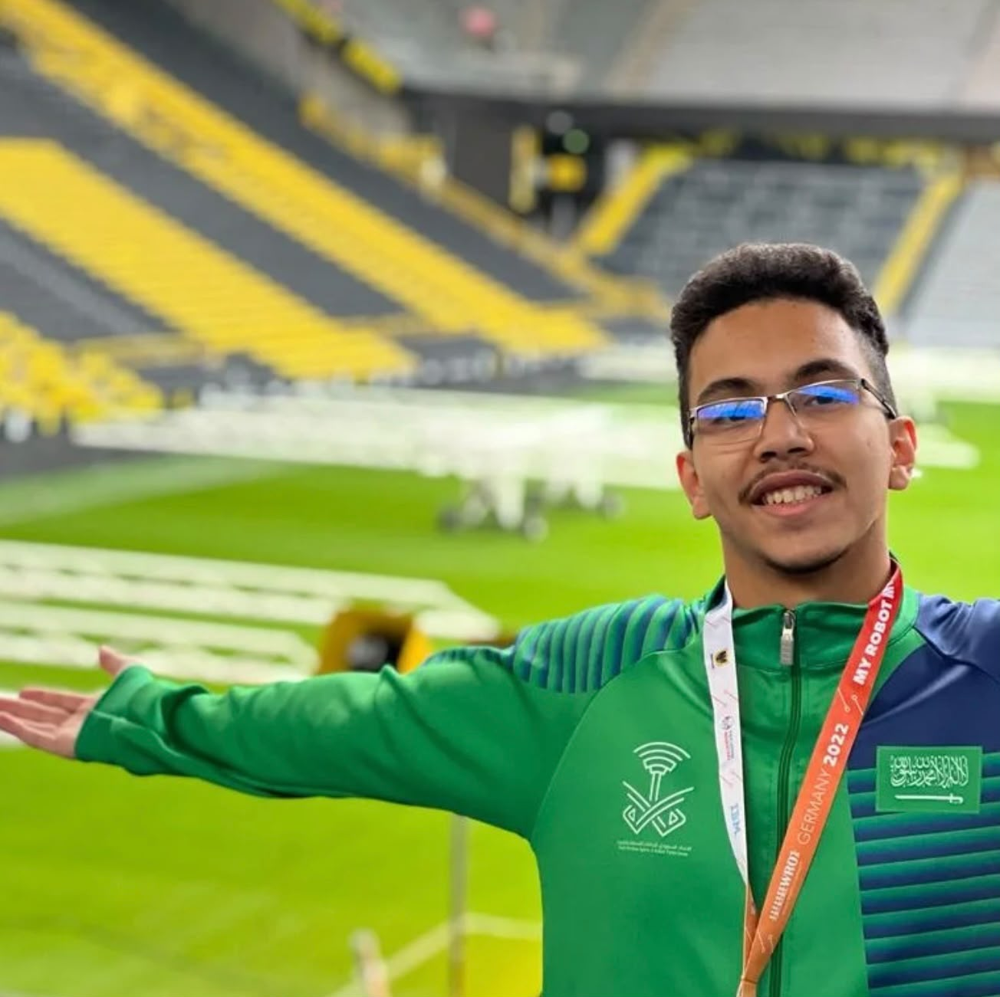

# Practice

<h1> Saudi Innovators 2030 

 This repository contains the documentation for the Saudi Innovators 2030 team's robot for the 2026 World Robot Olympiad Future Engineers competition. The robot was designed and built by a team of three students.
 
------------------------------------------------------------------------
 ## Table of contents
* [The Team](#team) 
* [Strategy of the Robot](#strategy)
  * [Open Rounded](#open)
  * [Obstacle Round](#obstacle)
* [How the Arduino](#harduino)
* [Robot Components](#robotcomponents)
  * [Arduino Mega2560](#arduinomega)
  * [Husky Lens 2](#huskylens)
  * [RN AI robot structure](#structure)
  * [Servo Motors](#smotors)
  * [DC Motor](#dc)
  * [Diffrential Mechanism](#diff)
  * [Ultrasonic Sensor](#ussensor)
  * [Gyro Sencor](#gyro)
  * [Voltage Regulator](#vregulator)
  * [Battery](#battery)
  * [Laser Cutter](#lasercutting)
------------------------------------------------------------------------
 ## The Team 

 ### Fahad Al-Zughaibi

  
Our robot combines computer vision, sensor feedback, and intelligent
control to navigate the field in both open and obstacle rounds.

Here is the YouTube video link for our robot open round → \[[https://youtu.be/EO0l7DpHomU?si=pYyQ_6kdtGGWtemz](https://youtu.be/YWj9p0f76Xo?si=jFrtSBgD9MeRDS3l)]

Here is the YouTube video link for our robot obstacles challenge  → \[[[https://youtu.be/EO0l7DpHomU?si=pYyQ_6kdtGGWtemz](https://youtu.be/8Ka8CMJKAJQ?si=VRpm_-UIFWR8-USU)https://youtu.be/8Ka8CMJKAJQ?si=VRpm_-UIFWR8-USU]

------------------------------------------------------------------------

## Strategy of the Robot 

### Open Round  

 In the open round, the robot's task is to complete three full loops around the arena without colliding with walls.  
 The HuskyLens 2 camera analyzes live frames (identifying blue and orange markers) to keep the robot on track and detect intersections.  
 The Arduino Mega 2560 processes sensor data, utilizes the MPU6050 IMU for yaw/heading control, and manages URM09 ultrasonic sensors to maintain safe distances from walls and corners.  
 A DC motor with encoder, BTS7960 driver, and steering servo provide precise movement, smooth turns, and 
consistent distance tracking at every corner.

------------------------------------------------------------------------
### Obstacle Round 

In the obstacle round, colored pillars (green and red) are placed along the path. The HuskyLens 2 processes the video, applies severity-based filtering, and identifies each pillar's color, position, and distance.  
 Green Pillar ➔ The Arduino Mega 2560 commands the steering servo and motor to turn left around the pillar.  
 Red Pillar ➔ The Arduino Mega 2560 commands the steering servo and motor to turn right around the pillar.  
The Arduino Mega 2560 executes these instructions through the BTS7960 driver, DC motor, and steering servo, while the URM09 ultrasonic sensors (including rear sensors) confirm safe movement and clearance. This system allows the robot to complete its loops intelligently, reacting dynamically to obstacles.o complete its loops intelligently,
reacting dynamically to obstacles.

------------------------------------------------------------------------

## how the Arduino Mega 2560 was utilized in the robot: 

The ESP32 acts as the low-level controller, receiving commands from the
Raspberry Pi and controlling the actuators.
Central Control: Manages the main software loop to operate the robot and execute decision-making.  
 Vision: Receives camera data (intersections and pillars) via UART.  
 Motion & Steering: Controls the drive motor and servo via the BTS7960 driver.  
 Sensors & Navigation: Reads the MPU6050 gyroscope to stabilize heading and URM09 sensors to avoid obstacles and center the robot in corridors.

------------------------------------------------------------------------

## Robot Components  

### Arduino Mega 2560  
The Arduino Mega 2560 serves as the main controller. It receives data from the HUSKYLENS 2 and controls:

DC motors for movement.
Servo motors for steering.
A buzzer for sound alerts. It also reads the MPU6050 gyro sensor to track heading and maintain accurate orientation.

------------------------------------------------------------------------

### HUSKYLENS 2 
The HuskyLens 2 is an AI-powered machine vision sensor designed to act as both the "eyes and brain" for robotics and embedded systems.

Edge AI Processing: It independently analyzes images to recognize colors, objects, lines, and faces, taking the computational load off the main microcontroller.
Click-to-Learn Training: Using its built-in screen and buttons, it can learn to identify new objects or colors instantly without requiring external computers or complex programming.
Ready-to-Use Data: It transmits processed results (X, Y coordinates, width, height, and IDs) directly to controllers like Arduino via UART or I2C, making it highly efficient for autonomous tasks for real-time image processing in robotics.

------------------------------------------------------------------------

### RN AI robot structure 

Base Chassis & Rails: Provides the lower perforated deck and main chassis rails that form the structural foundation of the robot.  
 Wheels & Drivetrain: Supplies the pre-built wheels and geared drive hubs used for mobility and movement.
 Mechanical Integration: Offers a solid and reliable mounting platform for the motors and base structure, which was extended using custom laser-cut acrylic boards for our electronics deck, camera mast, and sensors.

------------------------------------------------------------------------

### Servo Motors 

Used for steering and camera adjustments. Provide precise angular
positioning.

------------------------------------------------------------------------

### DC Motors 

Drive the robot's wheels, enabling forward and backward movement.

------------------------------------------------------------------------

### Differential Mechanism 

Ensures smooth turning by allowing rear wheels to rotate at different
speeds. Improves cornering and stability.

------------------------------------------------------------------------

### DF Ultrasonic Sensors 

Placed around the robot to provide *360° obstacle detection*. More
accurate and stable than traditional ultrasonic modules.

------------------------------------------------------------------------

### Gyro Sensor 

Measures angular velocity and orientation, sending feedback to the
Raspberry Pi via ESP32.

------------------------------------------------------------------------

### Battery 

A rechargeable battery serves as the primary power source for the entire
system. It is carefully selected to provide enough current to support
the Raspberry Pi, ESP32, and multiple motors simultaneously. The
capacity ensures that the robot can complete several rounds in
competition without recharging.

------------------------------------------------------------------------

### Voltage Regulator 

Since the battery provides higher voltage than the sensors and
controllers can handle, a voltage regulator is used to step it down to a
stable 5V. This prevents electrical noise or power surges from damaging
sensitive electronics such as the ESP32 and DF ultrasonic sensors.

------------------------------------------------------------------------

### Laser Cutting 

A laser cutter was used to manufacture acrylic plates that serve as
mounting bases for electronics. Acrylic was chosen for its rigidity and
precision, ensuring that all sensors and boards remain firmly in place
during high-speed movement.

------------------------------------------------------------------------

## Source Code

All source codes are available in the ⁠ src ⁠ directory.
